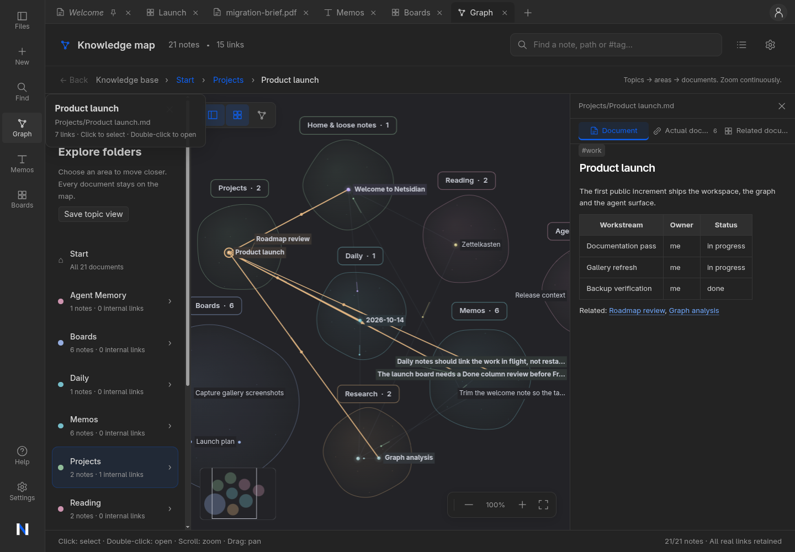
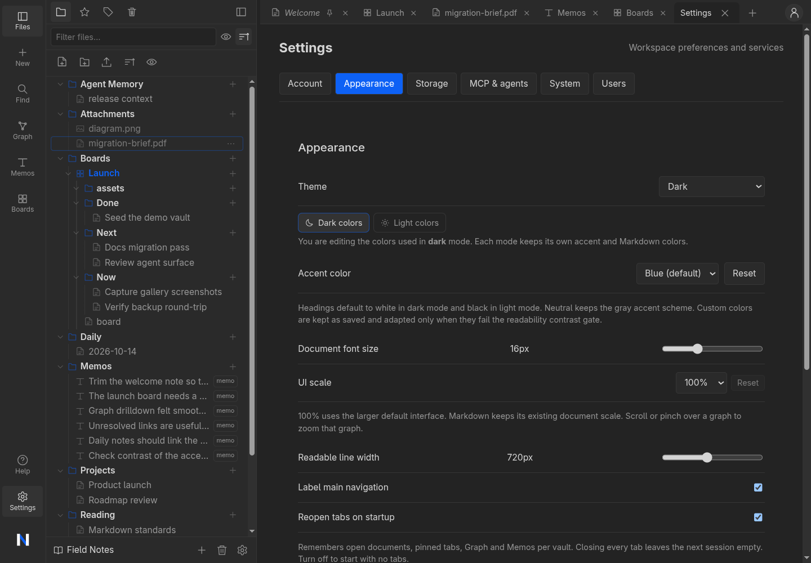
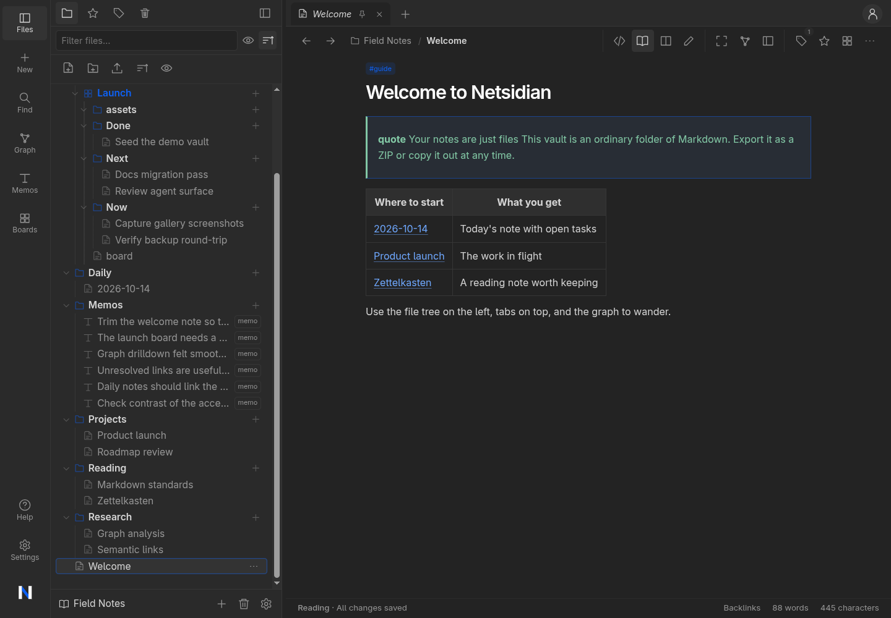
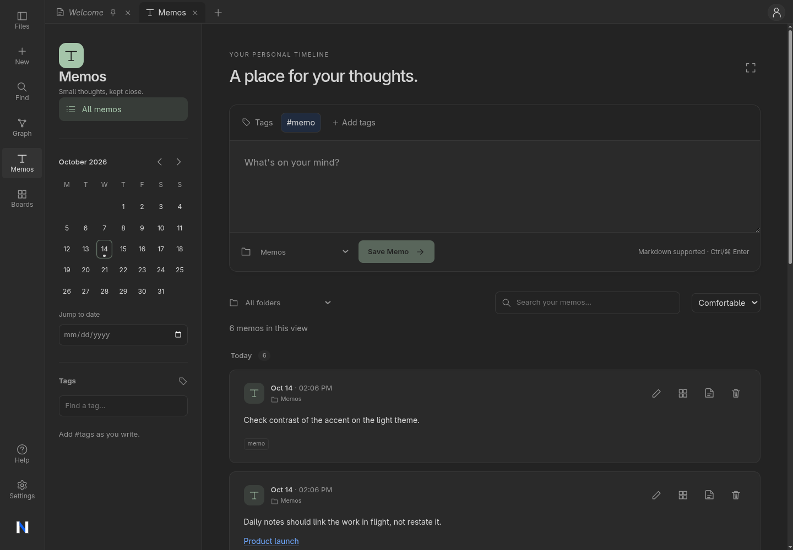
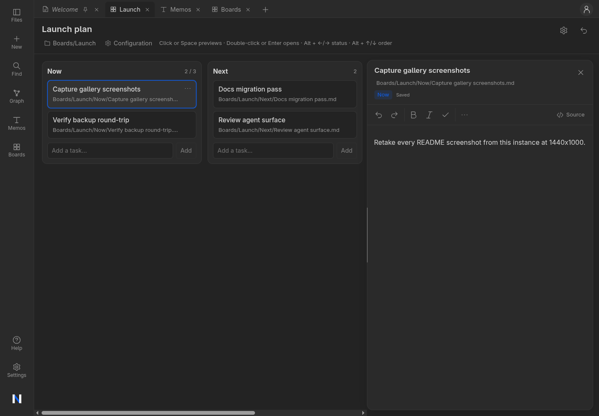
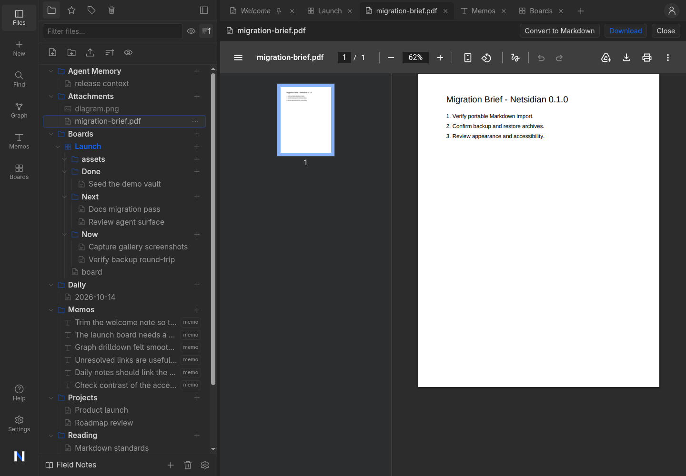
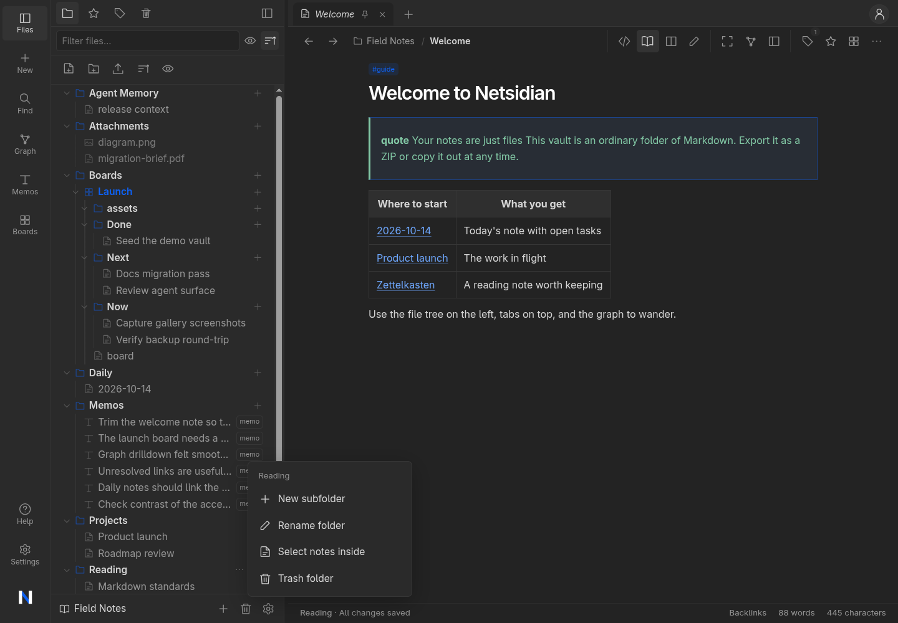
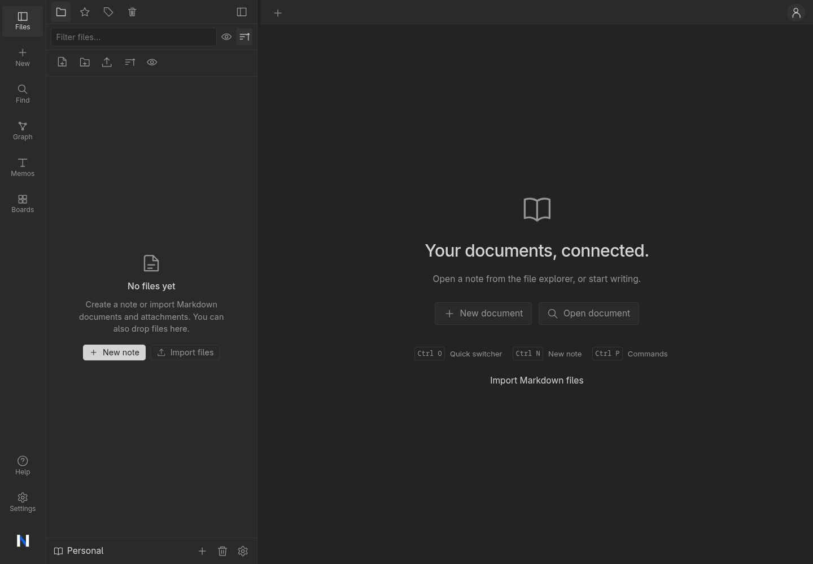
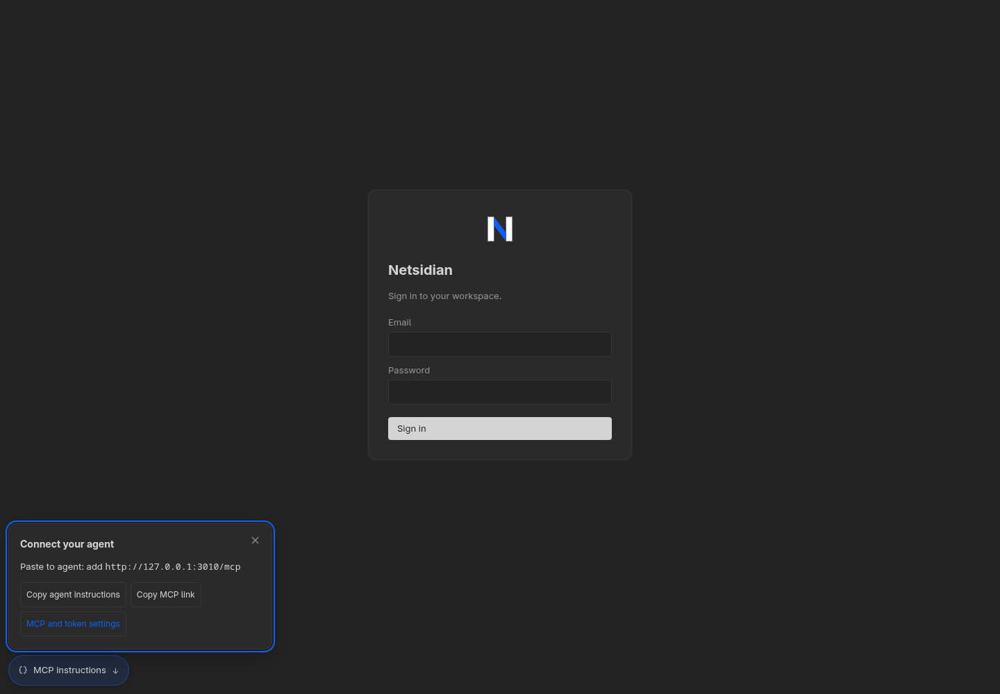

# Netsidian

**A web-native, Obsidian-style workspace for your Markdown notes, available in the browser and as a native desktop app, for you and your AI agent.**

Netsidian runs on hardware you control. Your notes stay plain `.md` files in a normal folder tree (portable to/from Obsidian), while Netsidian manages identity, revisions, search, links, and the graph around them in a single Go binary with SQLite. No external database, no SaaS, no telemetry.

---



## Features

- **Vaults (spaces)** — each vault is a real folder of Markdown files plus attachments; export the whole vault as a ZIP anytime
- **Three editors, one file** — CodeMirror source editor, Milkdown WYSIWYG (refuses to save anything it cannot round-trip losslessly), and a rich read view with callouts, tasks, and highlights
- **Revisions & history** — every save is an immutable revision; browse, diff-lite history feed, restore any version; op journal makes saves idempotent (safe retries)
- **Browser drafts** — ~750 ms autosave to localStorage with base-revision conflict detection; reload-safe
- **Links that work** — `[[wikilinks]]` + Markdown links, backlinks pane, unresolved-link previews, and a scoped **link-analysis API** (depth/direction/folder scope, node caps, truncated flags)
- **Graph navigation** — folder/community drilldown, vault search, connection exploration and an accessible document list
- **Full-text search**, folders with drag & drop, tabs, trash with retention, attachments up to 25 MB
- **Kanban boards** — folder-backed boards where tasks are ordinary notes and columns are folders; drag cards between columns or edit a task in a resizable preview beside the board ([guide](docs/kanban.md))
- **PDF document tabs** — PDFs open in workspace tabs; convert selectable text into a new Markdown note while the original stays untouched ([guide](docs/file-workflows.md))
- **Authentication** — private loopback mode, local accounts (Argon2id), OpenID Connect or both; scoped personal access tokens for agents; self-service password change that revokes every session and key
- **Appearance** — dark/light themes and accent presets with a built-in WCAG 4.5:1 contrast gate
- **Two run modes** — HTTP server (web) and native desktop app (Wails v3 + WebKitGTK)
- **Memo capture and daily notes** — folder-based quick capture, chronological history, reload-safe drafts and a daily note command
- **MCP for agents** — Streamable HTTP `/mcp`, copyable setup, scoped PATs, optional token-free desktop localhost access and a live API adapter; [connect](docs/mcp.md)
- **Agent document API** — scoped vault PATs, OpenAPI discovery, bounded search/graph retrieval, revision-aware writes and memory as ordinary Markdown
- **S3 storage** — optional S3-compatible managed vault storage
- **Verified backup & restore** — `netsidian backup` / `netsidian restore`: storage-aware archives covering state, managed content, attached folders and S3 vaults, with checksums and post-restore verification; [guide](docs/backup.md)
- **Mobile-friendly** responsive workspace


## Quick start

### Docker (web app, single host)

```bash
git clone https://github.com/pentaqilo/netsidian.git && cd netsidian
docker build -t netsidian:local .
docker run -d --name netsidian \
  -p 127.0.0.1:3000:3000 \
  -v netsidian-state:/netsidian-state \
  netsidian:local
```

Open <http://127.0.0.1:3000> — the first visit takes you through a one-time setup to create the operator account.

The image binds `0.0.0.0` with `local` auth; publishing the port is up to you (see [deployment guide](docs/deployment.md)). All state lives in the `netsidian-state` volume; back it up as one unit.

### Docker Compose

```yaml
services:
  netsidian:
    build: .
    image: netsidian:local
    restart: unless-stopped
    ports: ["127.0.0.1:3000:3000"]
    volumes: [netsidian-state:/netsidian-state]
volumes:
  netsidian-state:
```

### Desktop app (Linux)

Build from source with Node 20+, Go ≥ 1.27.1, GTK4 and WebKitGTK-6.0. Run `task build-desktop`, then `./bin/netsidian-desktop`. `Dockerfile.desktop-build` provides the native build toolchain for container builds.

Desktop instances use the local principal. Optional localhost MCP is configured in **Settings → MCP & agents**; select vaults and permissions, enable token-free access if desired, then copy the agent instructions.

### From source

```bash
task default        # build SPA + server binary → bin/netsidian
task run            # run locally on http://127.0.0.1:3000 (auth=none)
```

No [Taskfile](https://taskfile.dev)? See the [development guide](docs/development.md) for the exact plain `go`/`npm` commands.

## Architecture

Hexagonal core, two transports, one embedded SPA:

```
transport (httpapi │ wails native) ─→ service ─→ ports ─→ sqlite + local content store
```

| Path | What lives there |
|---|---|
| `internal/service/` | All business logic (documents, revisions, spaces, graph analysis, search…) |
| `internal/ports/` | Capability interfaces the services depend on |
| `internal/repository/sqlite/`, `internal/storage/local/` | Adapters: SQLite metadata + Markdown/attachment content on disk |
| `internal/transport/httpapi/` | REST API `/api/v1` (cookie sessions, `X-Netsidian-Requested: 1` on non-GET) |
| `internal/bootstrap/` | Composition root; build tag `server` vs native (Wails v3) |
| `frontend/` | React 19 + Vite 7 SPA (embedded into the binary) |
| `migrations/` | SQL migrations, applied at startup |
| `helm/netsidian/` | Kubernetes/Helm chart (single-node tested) |
| `docs/` | Installation, configuration, usage, deployment guides |
| `wiki/` | Living architecture wiki for contributors ([start here](wiki/index.md)) |

Health: `GET /healthz` (alias `GET /api/v1/health`).

## Configuration

Zero-config by default; every knob is a `NETSIDIAN_*` environment variable. The important ones:

| Variable | Default | Notes |
|---|---|---|
| `NETSIDIAN_BIND` / `NETSIDIAN_PORT` | `127.0.0.1` / `3000` | `none` auth **refuses** to bind a public interface |
| `NETSIDIAN_AUTH_MODE` | `none` | `none` \| `local` (accounts) |
| `NETSIDIAN_STATE_DIR` | `~/.local/state/netsidian` | DB, journal, history, secrets, content root |
| `NETSIDIAN_SIGNUP_ENABLED` | `false` (Docker: `true`) | Allow additional regular accounts after first administrator setup; set `false` to close registration |
| `NETSIDIAN_TRUSTED_PROXY` / `NETSIDIAN_PUBLIC_URL` | off / — | For a TLS reverse proxy |

Full reference with data locations and security notes: **[docs/configuration.md](docs/configuration.md)**.

## Documentation

| Guide | Contents |
|---|---|
| [Docs home](docs/README.md) | Where to start, full guide index |
| [Installation](docs/installation.md) | Docker, Compose, Kubernetes/Helm, desktop, from source |
| [Getting started](docs/getting-started.md) | Setup, vaults, editors, links, graph, search |
| [Migration and namespaces](docs/migration.md) | Fresh instance state, portable content and renamed integration contracts |
| [Configuration](docs/configuration.md) | Every env var, state dir layout, security model |
| [Deployment](docs/deployment.md) | Reverse proxy, HTTPS, backups, Kubernetes |
| [Development](docs/development.md) | Build, test, repo tour, code conventions |
| [Troubleshooting](docs/troubleshooting.md) | Common failures and fixes |
| [Architecture](docs/architecture.md) | Hexagonal core, transports, invariants |
| [Data model](docs/data-model.md) | Vaults, documents, revisions, links, storage |
| [Authentication](docs/authentication.md) | Modes, sessions, CSRF, API keys, OIDC |
| [API reference](docs/api.md) | Full REST + agent interface, schemas, examples |
| [MCP setup and design](docs/mcp.md) | Installation, live API adapter, memory conventions and ten validation rounds |
| [Agents guide](docs/agents.md) | PATs, memory-as-Markdown, agent workflow |
| [Contributor wiki](wiki/index.md) | Deep, cross-linked architecture notes |


## Releases

Download Windows, Linux, and macOS desktop archives from [GitHub Releases](https://github.com/pentaqilo/netsidian/releases). Linux requires GTK4 and WebKitGTK 6.0; Windows requires WebView2. macOS bundles are ad-hoc signed, not notarized.

The Docker image is `ghcr.io/pentaqilo/netsidian:0.1.0` (Linux amd64/arm64). Release downloads include the packaged [Helm chart](helm/README.md), SHA-256 checksums and the immutable container digest.

```sh
docker run -d --name netsidian -p 127.0.0.1:3000:3000 \
  -v netsidian-state:/netsidian-state ghcr.io/pentaqilo/netsidian:0.1.0
```

Release automation runs on version tags such as `0.1.0`. It publishes the GitHub release after all desktop builds, backend tests, Helm chart validation, and container publication succeed.

# Gallery

### Appearance settings



### Markdown document view



### Memos timeline



### Kanban boards with task previews



### PDF document tabs with Markdown conversion



### File explorer and empty vault





### Sign-in with MCP instructions




## Requirements & status

Netsidian is developed in reviewed increments (workspace, vaults & graph, ergonomics, editing & native vaults are complete). The product ships honest rough edges: check the issue tracker before filing duplicates.

## License

Netsidian is licensed under the [Apache License 2.0](LICENSE).

---

*Built with Go 1.27, React 19, CodeMirror 6, Milkdown, Cytoscape, and Wails v3. Your notes are just files — Netsidian only ever adds folders it clearly owns.*
