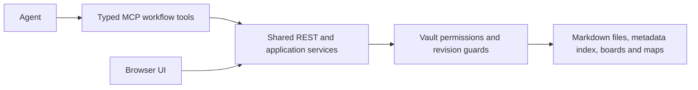

# MCP for knowledge and project work

Status: reviewed design and implementation backlog, 2026-10-20. This document describes proposed workflow tools, not tools already shipped. The current operational contract remains [mcp.md](mcp.md) and [mcp-design.md](mcp-design.md). The file-explorer and collection-list changes accompanying this review do not implement this MCP redesign.

## Finding

Keep the current transport, authorization and REST/service layer. Add a small, typed workflow interface above it. Netsidian already has the data model needed for a useful knowledge and project tool: ordinary Markdown documents, scoped vaults, folders, links, maps and folder-backed task boards. Replacing these with a separate agent-memory database would split the truth.

The principal weakness is usability for agents, not a missing MCP implementation. Today a model must discover an operation, inspect an HTTP-shaped schema, choose path/query/body parameters and interpret a REST envelope. That is flexible for an API specialist but expensive and error-prone for a smaller model. Generic coverage should remain an escape hatch; common work should require no HTTP knowledge.

## Code review: present versus missing

| Area | Present in the repository | Gap to address |
| --- | --- | --- |
| Transport | Official Go SDK, Streamable HTTP, bounded stateless replies, cancellation, timeout, Origin/Host checks | Test negotiated protocol versions against supported clients; do not assume the pinned SDK implements every newer revision |
| Access | Scoped expiring/revocable PATs, vault membership intersection, separate desktop policy, invocation-time authorization | An ordinary PAT is user-owned; managed service identities, organization lifecycle and OAuth onboarding are not supplied by this adapter |
| API reuse | Live registry, classified unavailable routes, in-process normal REST dispatch | Route discovery is capability coverage, not a task-oriented interface |
| Knowledge | Indexed lexical search, tags/folders, bounded agent/context with optional graph evidence, revisions, changes/since | First-class tools, revision-pinned document sections, typed output and task-specific retrieval plans |
| Writes | If-Match, idempotency, normal document history and journaled moves | Exact guarded patch workflow, consistent recovery codes, concise receipts with a reliable read-after-write reference |
| Boards | Task create/move/reorder and completion/WIP metadata are reachable through the generic adapter | Compact project progress and filtered task retrieval, without loading every full board |
| Maps | Read/update canvas, create/reference/move/remove nodes and linked files are reachable | A bounded neighborhood/document-link workflow that does not require hand-authoring all canvas metadata |
| Context budget | Agent context defaults to 8 results / 8192 bytes; adapter capture defaults to 64 KiB, max 256 KiB | Generic capture limits are not a model-context policy; projection occurs after capture and cannot rescue an oversized response |
| Output | Text content containing JSON and isError; REST status, ETag, retry/correlation information | Typed structured output schemas and small, consistent domain errors; do not describe text-only JSON as structuredContent |
| Discovery | Five authenticated tools including connect/discover/read/write/compatibility | Catalog availability is not per-caller permission proof; reduce irrelevant operations while retaining call-time enforcement |
| Company use | Shared vaults and normal access checks provide a foundation | Project manifests, cross-vault budgeted retrieval, service accounts, coordination and operational reporting need explicit design and tests |

Evidence: `internal/transport/httpapi/mcp.go`, `desktop_mcp.go`, `mcp_test.go`; `internal/service/agent.go`, `boards.go`, `mindmaps.go`; `internal/transport/httpapi/server.go`. Board columns already have an explicit `completion` flag: completion must not be guessed from a translated label such as Done. Existing scope and conflict checks should be reused rather than bypassed in convenience tools.



## One source of truth

Use a project vault for a real access boundary. A folder inside a vault is organization, not a private sub-tenant. Shared company knowledge can live in a separate vault with separately granted access. A model must never silently search all company data because the user omitted a project.

Suggested portable structure, configurable rather than mandatory:

```text
Projects/Website/
  project.md
  Knowledge/
  Decisions/
  Memos/
  Tasks/Delivery/board.md
  Tasks/Delivery/todo/*.md
  Tasks/Delivery/in-progress/*.md
  Tasks/Delivery/done/*.md
  Maps/Architecture/mindmap.md
```

A future versioned `project.md` manifest identifies the project and references its knowledge roots, board configuration documents and maps. Resolve stable configuration-document IDs to their current paths so renames do not silently detach a project. Validate actual document markers and current vault access; a filename alone is not a board/map declaration. Existing folders remain usable without a manifest. Manifest adoption is explicit and does not move files or grant access.

Task status remains its configured board column folder. Shared task content stays in Markdown; a second global status field would drift. Map membership is a document reference; linking to a map does not move a document. Physical moves remain explicit. Maps express spatial/semantic connections, while indexed document links remain the navigable knowledge graph. Neither alone is an authorization boundary or an authoritative task dependency graph.

## Proposed initial tool surface

Names below are a proposed versioned contract. Preserve existing generic tools for compatibility and migrate guidance/examples to domain tools first. Keep descriptions short, ordered deterministically and stable so clients can cache them. Measure the combined definition cost; do not replace five generic tools with hundreds of thin endpoint wrappers.

| Tool | Small, explicit inputs | Result / API reuse |
| --- | --- | --- |
| Existing `netsidian_connect` | No credentials in arguments | Auth state, contract/limits and next step; authenticated capability summary from agent/whoami |
| `netsidian_browse` | vault, kind (folders/boards/maps), parent, cursor, limit | Paged metadata and stable refs; no document bodies |
| `netsidian_search` | vault, query or folder/tags, cursor, byte budget | Reuse bounded agent/context; ranked excerpts with ID/path/revision and next cursor |
| `netsidian_read_document` | vault, document ID, section/cursor, expected revision, byte budget | Revision-pinned chunk, heading/line bounds and continuation, not an implicitly truncated full file |
| `netsidian_create_document` | vault, path, Markdown, idempotency key | Existing create route; concise document ID/path/revision receipt |
| `netsidian_edit_document` | vault, document ID, expected revision, old text, replacement, idempotency key | Require exactly one old-text match; guarded SaveContent, preserving all surrounding frontmatter/text |
| `netsidian_project_context` | vault, project/board ref, byte budget | Authorized compact counts, completion categories, warnings, relevant document refs and map refs |
| `netsidian_list_tasks` | vault, board ref, column, cursor, limit | Small task summaries with column IDs, current document revisions and paths |
| `netsidian_create_task` | vault, board ref, column ID, title, Markdown, idempotency key | Existing task creation workflow; membership is the resulting path |
| `netsidian_move_task` | vault, board ref, document ID, target column ID, expected revision and source path | Existing guarded task move, never a guessed filesystem rename |
| `netsidian_changes` | vault, cursor, limit | Existing durable changes/since to refresh cached refs and avoid rereading unchanged documents |

Add bounded map-neighborhood read and guarded map-edit tools in the next slice; common node/reference/connect actions should reuse the map service. Until then the existing generic adapter can perform them, with discovered schemas and revision guards. There is no claim that the proposed tools or section-reading routes exist yet.

Every new domain operation belongs in a reusable application service and documented REST contract, with the MCP handler translating only inputs/outputs. Reuse existing routes where complete; add a REST query/service for genuinely new aggregation or chunking. Do not embed authorization, progress calculation or filesystem operations solely in an MCP callback. This preserves browser/API parity and makes future non-MCP clients possible.

## Context discipline

Proposed workflow defaults, to be measured against real clients:

- Browse: 20 metadata records, 4 KiB target. Search: at most 8 snippets and 8 KiB including the envelope. Document chunk: 8 KiB default, 32 KiB hard ceiling. Project context: 8 KiB default, 16 KiB hard ceiling. Small mutation receipts: about 1 KiB. These are new facade limits; they do not describe today's generic adapter limits.
- Enforce serialized UTF-8 bytes on the whole domain response, including errors, cursors and metadata. Token counts are estimates, not promises. The existing 1024-byte minimum adapter capture is not an excuse for an unbounded domain output.
- Return metadata/snippets first, bodies on request. Paginate lists, pin chunks to a revision, report incomplete results explicitly. A reference is useful only if the caller can resolve it through a tool or authorized resource.
- Validate cursors against query, vault, authorization and generation. Existing agent-context cursors already reject scope/generation changes. Revalidate current access for every page and chunk, even when a cached cursor is valid.
- Cache by actor/grants, vault, query and revision/generation, with short lifetimes. Never share private response caches across principals. Changes/since invalidates content without refetching whole projects.
- Bound graph depth, node/edge counts, boards traversed, database work and response bytes separately. A small response does not guarantee a cheap query. Existing collection discovery reads configurations one by one; do not put that scan on every knowledge question.
- Prefer source citations `{documentId, path, revision, section}`. Use source text and computed counts, not hidden LLM summaries or asserted semantic-search relevance. Semantic retrieval can be added later with measured quality and the same access filtering.

Use the output/schema mechanisms of the negotiated MCP version. In the existing protocol profile, typed structuredContent plus a compact compatible text representation can aid clients; measure duplicated context rather than blindly emitting two full copies. Optional resource links/templates can let supporting hosts fetch chosen documents. Core workflows must still work with tools-only clients. The [MCP tools specification](https://modelcontextprotocol.io/specification/2026-07-28/server/tools) describes schemas, listing/caching and caller-dependent tool availability; the [resources model](https://modelcontextprotocol.io/specification/2025-11-25/server/resources) is host-driven context access, not permission to inject an entire vault.

## Writes, concurrency and recovery

For edits, use the exact revision read by the agent. No fuzzy patches, blind overwrite, inferred ETags or silent conflict retry. A patch matching zero/multiple places returns a precise error and leaves the file unchanged. Creating a duplicate path returns the existing conflict, not an automatic numeric suffix that hides a duplicate.

Keep one idempotency key per logical retryable mutation. Do not generate a fresh server-side key on every retry or claim exactly-once behavior for routes that lack durable deduplication. Before advertising a retryable high-level move/map edit, implement/test its service-level deduplication or return inspect-before-retry guidance. A timeout can mean completion is unknown. A successful write with an omitted body must never be repeated just to retrieve the receipt.

Use stable domain error codes, e.g. `REVISION_CONFLICT`, `AMBIGUOUS_MATCH`, `ACCESS_DENIED`, `CURSOR_EXPIRED`, `RATE_LIMITED`, `COMPLETION_UNKNOWN`, with the actionable next tool, current revision when authorized and safe, and Retry-After where relevant. Return a small receipt with old/new paths, revision and link-repair warnings. Do not disguise success as a generic failure that invites a duplicate write.

Concurrent agents need more than task status. An In progress folder is not an exclusive claim. Later add an explicit atomic lease/claim service (owner, expiry, compare-and-set), renewal and release, with an audit trail. Do not infer assignment, dependencies, due dates or estimates from free text. These need an opt-in shared metadata schema before agents can reliably coordinate company work.

## Honest project progress

Derive counts from actual task membership and the configured `completion` flag, including customized/localized columns. Return per-column counts, completed count, overflow/unassigned count, missing-configuration/file warnings and the snapshot revision/event generation. If reporting a ratio, name the denominator and include unassigned tasks; never imply that it measures effort, deadlines or business completion. Do not mark a task Done because a model says work is complete; move it only through the authorized explicit workflow.

Keep task lists separate from full document bodies and progress summaries. Aggregate only boards explicitly in the selected project. Project context should state which boards were included and what was omitted due to budget; do not present a partial scan as a complete company-wide report.

## Company-wide deployment

Build on least-privilege vault grants, short-lived credentials and per-request authorization. Introduce managed service identities with named owner/team, purpose, project grants, expiry/rotation/revocation and audit attribution before marketing this as an autonomous company platform. A human-owned shared PAT is a migration option, not a service-account lifecycle.

Retain audit correlation through MCP → REST → service, including principal/key, project/vault, affected document refs, operation outcome and revision. Keep secrets and document bodies out of operational logs. Define retention, backup/restore and administrator access policy with deployment owners; test tenant/vault isolation and access revocation during long workflows.

For general remote-client onboarding, implement a complete OAuth resource-server profile with trusted authorization-server discovery and audience-bound tokens, rather than describing existing browser OIDC login as MCP OAuth. The current manual PAT profile remains valid as an explicitly documented supported mode. Internal dispatch to Netsidian's own handlers is not forwarding a third-party token to an unrelated server. Follow [MCP authorization](https://modelcontextprotocol.io/specification/2026-07-28/basic/authorization) and [security guidance](https://modelcontextprotocol.io/specification/2026-07-28/basic/security_best_practices) when adding the OAuth profile; do not widen localhost/token-free desktop access into a remote enterprise bypass.

Retrieved Markdown is untrusted project data. The server must never execute instructions embedded in a note, load a referenced URL automatically or promote a document's text into system instructions. Client instructions should state this, while server authorization and bounded traversal remain enforceable independently of model obedience.

## Delivery and acceptance

1. **Audit/design (this change):** preserve the adapter, document current behavior and gaps, validate its existing protocol/permission/context tests. No new workflow tools, project schema or enterprise-readiness claim.
2. **Knowledge tools:** connect capabilities, browse/search/read/create/exact edit, shared REST service contracts, output budgets, revision-pinned chunks and error receipts. Keep API compatibility.
3. **Project and map workflows:** compact progress/task tools, opt-in manifests, bounded map neighborhoods and guarded mutations, service-level pagination/deduplication and an explicit read-only mode.
4. **Company operations:** service identities, OAuth interoperability, leases, audit/operations dashboards, optional cross-vault and semantic retrieval after isolation/performance evaluation.

Evaluate with the configured smaller model as well as a stronger model, on realistic authorized fixtures: find a decision and cite its revision; update it without altering neighboring text; create a task without duplicates; report custom completion columns/overflow correctly; move a task while another agent edits it; link a document into a map without moving it; resume from a cursor; retain correct behavior after token revocation; reject foreign-vault refs and instructions embedded in retrieved notes. Record task success, tool calls, schema errors, response bytes, estimated tokens, latency, conflict recovery, duplicate/lost edits and permission leaks. Require zero unauthorized mutations/lost edits and budget violations in the acceptance fixtures; set latency and success-rate targets from a measured baseline. Ergonomics should be demonstrated, not assumed from model size. This evaluation approach follows the practical emphasis in [Writing tools for agents](https://www.anthropic.com/engineering/writing-tools-for-agents).

### Implemented follow-up from reader testing (0.4.0)

Credential-aware connection summaries, read-only/core-grant discovery filtering,
path-read guidance, direct document reads through `documents/by-path`, and
mind-map configuration-file read aliases are now implemented. These small
compatibility improvements reuse the current service and REST layer. The larger
typed knowledge/project tool facade proposed above remains a design backlog.

### Implemented focused tools (0.4.0)

The current slice now implements `netsidian_search`,
`netsidian_document_read/create/update` and `netsidian_memory_recall/remember`.
See [the concrete contracts and limits](mcp.md#focused-tools-and-indexed-memory).
These names supersede the earlier proposed document-tool names in the table
above. Browse, project/task aggregation, exact-text patching and map-neighborhood
tools remain future work. Indexed memory stays in ordinary Markdown with linked
resources; it does not restore the retired dedicated memory workflow.

## Proposed project/work wiki workflow (2026-10-22; not implemented)

When the user asks to persist project documentation or ongoing work, prefer a
project wiki in an existing authorized vault over a long personal-memory entry.
The memory index holds a short project pointer; project documents, the board and
map remain the authoritative sources. Local repository paths are plain context
metadata, not external URLs or substitutes for internal document links.

A small default project template:

```text
Projects/VibroTrack/
  project.md                 # manifest, purpose, entry links
  Wiki/
    Context.md               # goals, constraints, architecture and source refs
    Decisions.md             # decisions with reasons and dates
    Handover.md              # verified checkpoint, blockers, next steps
  Work/
    board.md
    todo/
    in-progress/
    done/
  Maps/Overview/
    mindmap.md               # references existing wiki/task files
```

Create useful documents as needed, not every possible empty folder/page.
`project.md` contains a versioned project marker and stable document IDs for its
wiki roles, board configuration and overview map. It is also the landing page;
a duplicate README or parallel status document is unnecessary. Board column
folders remain the source of task status. Handover records a dated checkpoint
and task links, not a second mutable task database. Map nodes reference the same
files instead of copying their bodies. Semantic map edges are not automatically
Jira-style task dependencies.

Agent guidance should make persistence routine when authorized: discover/reuse
an existing project; initialize a small wiki for a new project; put actionable
multi-step work on its board; add a meaningful overview/architecture map when
relationships benefit from a diagram. Do not create a board/map for an unrelated
personal preference, invent project facts or completion, or recreate an existing
project for each session. Do not create a new vault by default: folders organize
work, vault membership defines access. Explicit read-only denials must never be
reported as successful persistence.

Recommended focused additions, staged after the memory-link reliability fix:

| Tool | Responsibility |
| --- | --- |
| `netsidian_project_prepare` | Find/adopt/create a project from a named template, returning a small receipt and internal refs. Replay-safe; existing files are not overwritten. |
| `netsidian_project_context` | Budgeted entry point: purpose, source refs, current board counts, blockers and selected next tasks; optional bounded map neighborhood. No full wiki download. |
| `netsidian_project_record` | Record a context note, decision or handover in the manifest-selected wiki document, with revision checks and exact append/section rules. |
| `netsidian_task_create` | Create an ordinary task file in the project's configured board column. |
| `netsidian_task_move` | Change status via the guarded board move service, using actual column IDs and current revision. |
| `netsidian_map_link` | Reference existing project documents/tasks and connect them, with safe initial placement and preservation of manually arranged nodes. |

Reuse document/search/memory tools for bodies and targeted retrieval. A paged
board/task reader and dedicated map-neighborhood tool can follow if the context
tool's small projections are insufficient; avoid adding a tool per REST route.
Project context should default to roughly 4–8 KiB of serialized JSON with opt-in
sections and continuations; mutation receipts should contain IDs/revisions rather
than echoed documents. Measure the additional tool-schema cost before finalizing
contracts. Counts use column completion metadata, not the translated column label.

Project provisioning must journal its multi-file progress and reconcile identical
retries. An interrupted scaffold is reported as partial, not complete; retry must
reuse already-created files. Concurrent edits require fresh revisions, safe merge
or an explicit conflict. Link renames/trash and current permissions must be
rechecked. Implement reusable application services/REST capabilities, with MCP
as a small typed facade. Existing arbitrary folders need explicit adoption,
without automatic moves or mass migration.

Suggested acceptance scenario: persist a project, obtain a linked wiki and board,
record a real decision, create/move a task, link its evidence on a map, then resume
from a small context response in a fresh agent session. Repeat provisioning,
rename/trash a referenced document, race an edit and test read-only/cross-vault
keys. Confirm no duplicate project, no copied task status, no externalized local
filesystem path and no unbounded context response. This section is a proposal;
the project/task/map workflow tools listed here do not exist yet.
